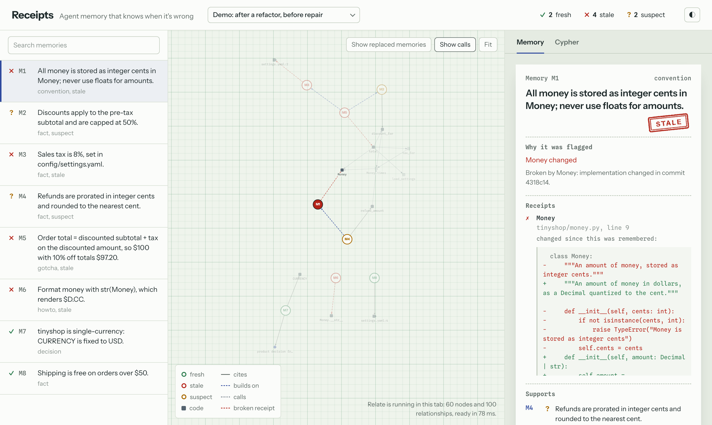

# Receipts

**Agent memory that knows when it's wrong.** Every fact a coding agent remembers cites the code that proves it.
[Relate](https://github.com/relatedb/relate), Neo4j's embedded graph database, keeps those receipts linked to the
code and works out which memories stopped being true when the code changes.

**[Open the live memory graph](https://receipts-memory.vercel.app/)** (Relate runs in your browser tab as
WebAssembly; mirror on [GitHub Pages](https://karthik7271.github.io/receipts/)) · Try it locally in one command: `uvx --from git+https://github.com/karthik7271/receipts receipts demo`

[](https://receipts-memory.vercel.app/?m=M1)

## The problem

Coding agents keep memory between sessions: `CLAUDE.md` files, memory tools, vector stores of learned facts. None of
them record *why* a fact is true, so none of them notice when it stops being true. A teammate refactors, and the next
session repeats the old fact with full confidence. A confident wrong memory is worse than none.

## What Receipts does

1. **No receipt, no memory.** `remember` only accepts a claim that cites real code: a function or class
   (`money.py::Money`), an exact quoted line (`settings.yaml: "tax_rate: 0.08"`), or a file. A citation that points at
   nothing is rejected.
2. **One graph holds memories, code and the links between them.** Memories `CITE` code, code `CALLS` code, files
   `IMPORT` files, memories are `DERIVED_FROM` other memories, and each code `Change` points `ON` what it changed.
3. **When code changes, the graph decides what's still true:**

| Status | Why | The graph query behind it |
|---|---|---|
| ✗ **stale** | the cited code's behaviour changed, it was deleted, or the quoted line is gone | `(:Fact)-[:CITES]->(:Symbol)` with a fingerprint mismatch |
| ? **suspect** | code it depends on, up to 2 calls away, changed its contract (parameters or type hints) | `(:Fact)-[:CITES]->(:Symbol)-[:CALLS]->{1,2}(:Symbol)<-[:ON]-(:Change)` |
| ? **suspect** | a memory it builds on is stale, suspect, retracted or replaced, at any depth | `(:Fact)-[:DERIVED_FROM]->+(:Fact)` |
| ✓ **fresh** | none of the above, including after reformatting, comment, docstring or type-hint-only edits, and renames | behaviour fingerprints, `MOVED_TO` |

4. **The agent is told at the right moment**, through Claude Code hooks:
   - at session start: *"M1 [STALE] … (Flask._find_error_handler was deleted) … verify, then revise"*;
   - right after it edits code that a memory cites;
   - after a `git pull`, `checkout` or `merge`;
   - when it opens a file: what earlier sessions learned about it;
   - before it stops, if it studied code but saved nothing: *"anything durable worth remembering?"* (once per session).
5. **It repairs its own memory.** `verify` shows the diff that broke a memory. `reaffirm`, `revise` and `retract`
   keep the full history (`SUPERSEDES`, `VERIFIED`), and derivations are re-pointed to the newest version.

The idea is a 1979 one: Jon Doyle's *Truth Maintenance System* gave AI programs beliefs with justifications, so that
withdrawing a justification withdraws the belief. A graph database is what makes it practical for agents.

## Proven on real code

**Claude Code on Flask, unprompted** ([`examples/live-flask`](examples/live-flask/)). Neither prompt mentions memory.
1. **Flask 2.3.0.** Asked how Flask picks an error handler, the agent answered. When it was about to stop, it saved one
   non-obvious fact: status-code handlers beat exception-class handlers, even across blueprints.
2. **The repo moves to Flask 3.1.0.** The function was moved into `flask/sansio/app.py` and gained a parameter.
3. **A fresh session asks an upgrade question.** The session-start hook said the memory was **stale** before the
   agent read anything. It re-checked the new code, **revised** the memory to the new location, and answered: the
   precedence rules are unchanged.

The two sessions cost **$0.07** and **$0.22**.

**How noisy is it on real history?** [`benchmarks/history.py`](benchmarks/history.py) replays real releases through
the actual Relate pipeline. It treats every function and class of the older release as if a memory cited it, then
counts what each kind of receipt would flag at the newer release:

| Releases | Cited symbols | Receipt = the file | Receipt = exact text | **Receipts** | Cosmetic edits ignored | Renames/moves followed |
|---|---|---|---|---|---|---|
| Flask 2.2.0 → 2.3.0 | 391 | 100% | 55% | **19%** | 142 | 0 |
| Flask 2.3.0 → 3.0.0 | 373 | 75% | 35% | **10%** | 13 | 79 |
| Flask 3.0.0 → 3.1.0 | 370 | 100% | 43% | **16%** | 99 | 0 |
| Requests 2.28.0 → 2.31.0 | 292 | 58% | 5% | **4%** | 3 | 0 |
| Requests 2.31.0 → 2.32.0 | 292 | 100% | 98% | **13%** | 0 | 250 |

Every change to the cited code's behaviour is still caught. A contract change made a median of 1 to 2.5 other
memories suspect (16 at most), so it doesn't flood. When Requests moved its whole package into `src/`, exact-text receipts would have
invalidated 98% of memories; Receipts followed all 250 moves.

**Scale.** On Django (4,300 files, 40k symbols, 54k call edges) the first scan takes 17 s. After that, a session start
on an unchanged repo takes about 1 s, and each hook after an edit about 0.1 s.

## How it compares

| | Notes / `CLAUDE.md` | Vector memory | **Receipts** |
|---|---|---|---|
| Says why a fact is true | no | no | cites the exact code |
| Notices when it stops being true | no | no | yes, on every sync |
| Ignores reformatting and renames | n/a | n/a | yes |
| Knows what *depends on* a fact | no | no | `DERIVED_FROM` and `CALLS` paths |
| Repair with history | manual edits | overwrite | `verify`, `revise`, `reaffirm`, `retract` |
| Runs where the agent runs | a file | usually a service | an embedded `.rl` file, no server |

## Why Relate

- **Embedded and in-process.** Every hook, MCP call and CLI command opens the store, runs one transaction and closes
  it. That's why it can run after every tool call: no server to start, no account.
- **One `.rl` file per repository** (`.receipts/memory.rl`). Commit it and the team shares one memory, re-checked
  against whatever each person has checked out.
- **Cypher with modern path patterns.** Staleness is three queries using quantified path patterns (`->+`,
  `->{1,2}`) and `EXISTS {}` subqueries. `recall` combines Relate's full-text index with graph expansion over
  `CALLS`, `IMPORTS` and `DERIVED_FROM`.
- **The same engine in the browser.** The viewer replays the store into `@relate/relate-wasm`, and every panel is a
  Cypher query in your tab, including a console with sample queries.

## Use it

```bash
uv tool install git+https://github.com/karthik7271/receipts     # or: pipx install git+https://…
cd your-repo
receipts install      # Claude Code: MCP server + hooks, and a first scan of the code graph
claude
```

**Cursor, Claude Desktop or any MCP client:** add a server that runs `receipts mcp` for your repository.

```json
{ "mcpServers": { "receipts": { "command": "receipts", "args": ["--repo", "/path/to/your/repo", "mcp"] } } }
```

That's `.cursor/mcp.json` for Cursor, or `claude_desktop_config.json` for Claude Desktop. The hooks are Claude Code
only; elsewhere the agent uses the tools directly, and `receipts status` re-syncs.

**MCP tools:**

| Tool | What it does |
|---|---|
| `recall` | Full-text search **plus graph expansion**: memories about callers and callees, importing files, and derivation neighbours. Receipts are re-checked against the working tree before answering. |
| `remember` | Save a fact with receipts. Rejects citations that point at nothing, suggests a narrower one when a whole class or file is cited, and returns other memories citing the same code. |
| `verify` | A memory's receipts diffed against today's code, plus the change (and commit) that broke it. |
| `reaffirm` · `revise` · `retract` | Repair memory, keeping the history. |
| `impact` | Before touching shared code: which memories depend on it, directly, through callers, or by derivation. |
| `memory_status` | Counts, the last sync, and what needs attention. |

**By hand:**

```bash
receipts demo                               # the 60-second story on a sample repo
receipts remember "Totals tax the discounted amount" -c "src/checkout.py::total" -k gotcha
receipts remember "Sales tax is 8%" -c "config/settings.yaml#tax_rate: 0.08"
receipts status                             # re-sync and show what needs attention
receipts recall "how is tax computed" -t src/checkout.py
receipts why M5                             # the graph behind one memory
receipts ui                                 # the viewer, for this repo's memory
receipts export --format claude-md          # a CLAUDE.md section of verified memories only
receipts heal --dry-run                     # optional: Claude reviews stale memories (needs an Anthropic API key)
```

`heal` handles memories parents-first (ordered by `DERIVED_FROM` depth). For each one it shows Claude
(`claude-opus-5-5`, structured output) the memory, why the graph flagged it, every receipt as remembered and as it is
now, and the memories it builds on. Claude answers `reaffirm`, `revise` (with new text and receipts), `retract` or
`unsure`. Install it with `pip install 'receipts-memory[heal] @ git+https://github.com/karthik7271/receipts'`.

## Inspect the stores

Three persistent Relate stores ship in [`examples/`](examples/):
- `tinyshop/`: the scripted demo;
- `live-flask/`: Claude Code on Flask, unprompted;
- `live-claude-code/`: Claude Code on tinyshop, prompted.

```bash
receipts --repo examples/tinyshop query \
  "MATCH (f:Fact)-[:INVALIDATED_BY]->(c:Change) RETURN c.detail AS change, collect(f.id) AS broke"
receipts --repo examples/live-flask why M2
python -c "import relate; db = relate.connect('examples/tinyshop/.receipts/memory.rl', read_only=True); \
  print(list(db.execute('MATCH (f:Fact) RETURN f.status AS s, count(*) AS n')))"
```

**Graph model.** Node labels: `Fact`, `Symbol`, `File`, `Source` (receipts only a person can vouch for), `Change`,
`Sync`, `Verification`. Relationships: `CITES {mode, hash, quote, snapshot, tick}`, `CALLS`, `DEFINES`, `IMPORTS`,
`DERIVED_FROM`, `SUPERSEDES`, `MOVED_TO`, `ON`, `RECORDED`, `INVALIDATED_BY`, `VERIFIED`. Ordering uses a logical
clock (`tick`), not wall time.

## How it works

| Module | Role |
|---|---|
| [`codegraph.py`](src/receipts/codegraph.py) | Scans the repo (respects `.gitignore`). For Python it builds AST symbols with three fingerprints: behaviour (no names, docstrings or type hints), shape (parameters), and canonical type hints. It also records calls and imports. JS/TS gets a lighter regex scan; other text files are tracked per file, for quote receipts. |
| [`graph.py`](src/receipts/graph.py) | Incremental sync into Relate: size/mtime, then content hash, then parse only real changes, written in committed batches. Records `Change` nodes, detects renames, and runs **`recompute_status`**, the truth-maintenance queries. |
| [`memory.py`](src/receipts/memory.py) | `remember`, `recall`, `verify`, `reaffirm`, `revise`, `retract`, `impact`. |
| [`mcp_server.py`](src/receipts/mcp_server.py) · [`hooks.py`](src/receipts/hooks.py) | A hand-rolled MCP stdio server (no SDK dependency, like Relate's own) and Claude Code hooks that never break a session (failures go to `.receipts/hook.log`). |
| [`heal.py`](src/receipts/heal.py) | Claude-powered memory repair. |
| [`viewer/index.html`](src/receipts/viewer/index.html) | Single-file viewer on Relate WASM and Cytoscape. |

**Limits.**
- **Call resolution is by name** (same class, same file, imports, then a unique global match), so dynamic dispatch the
  scanner can't see won't propagate.
- **Drift is driven by contracts.** A callee's *body* changing doesn't make its callers' memories suspect; its
  parameters or type hints changing does.
- **Python first.** JS/TS symbols come from a regex scan, and other languages are tracked per file.
- **One process at a time.** A store is used by one process at a time; access is serialised with a file lock, so
  concurrent tools wait a few milliseconds.
- **Quotes don't travel.** Quote receipts are tied to a file and don't follow text that moves to another file.

**Found along the way.** In relate-db 1.0.2, deleting a node or relationship created earlier in the *same open
transaction* panics (`update counters are non-negative`), and a single commit is capped at 64 MiB. Receipts commits
before every delete phase and writes large scans in batches.

## Development

```bash
uv sync && uv run pytest -q                 # 20 tests
uv run python benchmarks/history.py <clone of pallets/flask> 2.2.0 2.3.0 3.0.0 3.1.0
scripts/build_examples.sh                   # rebuild the demo store and the site in docs/
```

Built for the [Relate by Neo4j Hackathon](https://relate.devpost.com/). Code, docs and tests were written with Claude
Code (Anthropic), and Claude Code is also the agent in the live examples.

Apache-2.0
