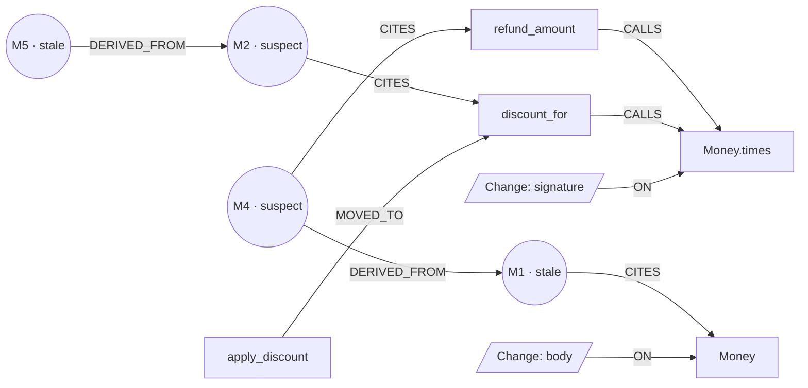

# Receipts

**Agent memory with receipts.** Every fact a coding agent remembers cites the code that proves it, and [Relate](https://github.com/relatedb/relate), Neo4j's embedded graph database, works out which memories stopped being true once that code changed.

> Your agent learned that *"all money is stored as integer cents."* Then a teammate switched `Money` to `Decimal`.
> Without Receipts, the next session repeats the old fact with full confidence. With Receipts, the agent is told the
> memory is **stale**, sees the diff that broke it, and is pointed to the three other memories that were built on it.

| | |
|---|---|
| 🧪 **Try it in 60 seconds** | `uvx --from git+https://github.com/karthik7271/receipts receipts demo` (no API key, no server) |
| 🌐 **Explore the graph in your browser** | [karthik7271.github.io/receipts](https://karthik7271.github.io/receipts/): Relate compiled to WebAssembly, running in the tab |
| 🎬 **Demo video** | _link added at submission_ |
| 🗄️ **Inspect the Relate stores** | [`examples/tinyshop/.receipts/memory.rl`](examples/tinyshop/.receipts/memory.rl) (scripted demo) · [`examples/live-claude-code/`](examples/live-claude-code/) (memories written by Claude Code over MCP) |

---

## The problem

Agents now keep memory between sessions: `CLAUDE.md` files, memory tools, vector stores of "learned facts". None of these know **why** a fact is true, so none of them notice when it stops being true. Memory rots quietly, and a confident wrong memory does more harm than no memory at all.

## The idea: truth maintenance, on a graph

In 1979, Jon Doyle's *Truth Maintenance System* gave AI programs beliefs with justifications: retract a justification and every belief that rested on it is withdrawn. Receipts brings that idea to coding agents, and Relate's graph is what makes it work:

1. **No receipt, no memory.** `remember` refuses a fact that doesn't cite real code: a symbol (`tinyshop/money.py::Money`), an exact quoted line (`config/settings.yaml: "tax_rate: 0.08"`), or a file. A fact only a person can vouch for gets an explicit `{note}` receipt.
2. **One graph holds the memories, the code, and the links between them.** Memories `CITE` symbols, symbols `CALL` symbols, files `IMPORT` files, memories are `DERIVED_FROM` other memories, and every code `Change` points `ON` the code it changed.
3. **Staleness propagates through the graph.** When the code changes, Relate does the reasoning:

| Status | What happened | Found by |
|---|---|---|
| ✗ **stale** | the memory's own receipt changed: body or signature changed, symbol deleted, quoted line gone | `(:Fact)-[:CITES]->(:Symbol)` with a hash mismatch |
| ? **suspect** (upstream drift) | code the receipt *calls*, up to 2 hops away, changed its signature | `(:Fact)-[:CITES]->(:Symbol)-[:CALLS]->{1,2}(:Symbol)<-[:ON]-(:Change {kind:'signature'})` |
| ? **suspect** (derived) | a memory it builds on is stale, suspect, retracted or superseded, at any depth | `(:Fact)-[:DERIVED_FROM]->+(:Fact)` |
| ✓ **fresh** | none of the above, including after reformatting or a pure rename | semantic hashes, `MOVED_TO` |

4. **It doesn't cry wolf.** Symbol hashes come from the AST, without names or docstrings. Reformatting or editing comments never invalidates a memory. When a function is renamed or moved, Relate records `(:Symbol)-[:MOVED_TO]->(:Symbol)` and the receipt **follows the rename**. Quotes match on token boundaries, so `tax_rate: 0.08` doesn't match inside `tax_rate: 0.0825`.



*The demo after a teammate's refactor. M2's receipt followed `apply_discount` → `discount_for`, but `Money.times` changed its signature two hops away, so M2 is suspect. M4's own code was only reformatted (no change), but it builds on stale M1.*

## What the agent experiences (Claude Code)

```bash
cd your-repo
receipts install      # writes .mcp.json (MCP server) + .claude/settings.json (hooks), scans the code graph
claude
```

- **Session start** (hook): *"Receipts: 7 memories about this repo (0 fresh)… These memories no longer match the code. Don't trust them as written: M1 [STALE] Money is stored as integer cents… (Money changed; quoted text is gone from tinyshop/money.py)…"*
- **After every edit** (hook): *"Your edit to tinyshop/pricing.py changed code that these memories cite. Before you finish, `reaffirm`, `revise` or `retract`: M2 [STALE]…"*. The agent fixes its memory in the same change that broke it.
- **After a `git pull`, `checkout` or `merge`** (hook): full re-sync, then a list of what broke.
- **When it opens a file** (hook): what earlier sessions recorded about that file.
- **MCP tools**:

| Tool | What it does |
|---|---|
| `recall` | Full-text search (Relate `FULLTEXT INDEX`) **plus graph expansion**: memories about callers and callees (`CALLS`), importing files (`IMPORTS`), and derivation neighbours. Receipts are re-checked against the working tree before answering. |
| `remember` | Store a fact with receipts. Rejects receipts that point at nothing, and returns the other memories that cite the same code so the agent can merge or supersede. |
| `verify` | A memory's receipts diffed against today's code, plus the `Change` (and commit) that broke it. |
| `reaffirm` · `revise` · `retract` | Repair memory. History is kept (`SUPERSEDES`, `VERIFIED`), and derivations are re-pointed to the newest version. |
| `impact` | *Before* touching shared code: which memories depend on it directly, through callers, or by derivation. |
| `memory_status` | Counts, the last sync, and everything that needs attention. |

**This was run for real.** In [`examples/live-claude-code`](examples/live-claude-code/), Claude Code (Sonnet) onboarded onto tinyshop and remembered 7 facts through MCP. It found genuine gotchas: `Money.times` uses banker's rounding, and two settings keys are never read by any code. After the refactor, a fresh session was told all 7 were out of date at startup. It read the new code, revised 6 (*"…ROUND_HALF_UP (half-up, not banker's rounding)"*) and reaffirmed the 7th with a note. Open that store in the [browser viewer](https://karthik7271.github.io/receipts/?data=live-session.cypher).

## Why Relate

Receipts needs a graph that lives **inside** the agent's tools, not next to them:

- **Embedded and in-process.** Every hook, MCP call and CLI command opens the store, runs one transaction and closes it. A full hook (Python start, open, sync, answer) takes about 0.1 s, so it can run after *every* tool call. There's no server to start and no account.
- **One `.rl` file per repository** (`.receipts/memory.rl`). Commit it and the team shares one memory, verified against whatever checkout each person has.
- **Cypher with modern path patterns.** The propagation rules above are three short queries using quantified path patterns (`->+`, `->{1,2}`), `EXISTS {}` and `COUNT {}` subqueries, and `MERGE`. `recall` combines the full-text index with graph traversal in the same store.
- **The same engine everywhere.** The browser viewer replays the store into `@relate/relate-wasm` and runs every panel as a Cypher query in the tab, including a console with sample queries.

## Quick start

```bash
# the 60-second story on a sample repo (no API key, no server)
uvx --from git+https://github.com/karthik7271/receipts receipts demo

# or from a clone
git clone https://github.com/karthik7271/receipts && cd receipts
uv run receipts demo            # creates ./receipts-demo
uv run receipts --repo receipts-demo ui    # graph viewer (Relate WASM) at http://127.0.0.1:8765
```

Use it on your own repo:

```bash
uv tool install git+https://github.com/karthik7271/receipts   # or: pip install git+https://…
cd your-repo
receipts install                 # Claude Code: MCP server + hooks
# or drive it by hand:
receipts remember "Totals tax the discounted amount" -c "src/checkout.py::total" -k gotcha
receipts remember "Sales tax is 8%" -c "config/settings.yaml#tax_rate: 0.08"
receipts status                  # re-sync and show what needs attention
receipts recall "how is tax computed" -t src/checkout.py
receipts why M5                  # the graph behind one memory
receipts export --format claude-md   # a CLAUDE.md section of verified memories only
```

### Let Claude heal stale memory (optional)

```bash
pip install 'receipts-memory[heal] @ git+https://github.com/karthik7271/receipts'
receipts heal --dry-run          # needs ANTHROPIC_API_KEY or an `ant auth login` profile
```

`heal` walks stale and suspect memories **parents first** (ordered by `DERIVED_FROM` depth). For each one it shows Claude (`claude-opus-5-5`, structured output) the memory, why the graph flagged it, every receipt as remembered and as it is now, and the memories it builds on. Claude returns `reaffirm`, `revise` (with new text and receipts), `retract` or `unsure`. Run it in CI after merges and memory maintains itself.

## Inspect the stores

The repository ships two persistent Relate stores:

```bash
receipts --repo examples/tinyshop status --no-sync
receipts --repo examples/tinyshop query \
  "MATCH (f:Fact)-[:INVALIDATED_BY]->(c:Change) RETURN c.detail AS change, collect(f.id) AS broke"
python -c "import relate; db = relate.connect('examples/tinyshop/.receipts/memory.rl', read_only=True); \
  print(list(db.execute('MATCH (f:Fact) RETURN f.status AS s, count(*) AS n')))"
```

**Graph model.** Node labels: `Fact`, `Symbol`, `File`, `Source` (external receipts), `Change`, `Sync`, `Verification`, `Meta`. Relationships: `CITES {mode, hash, sig_hash, quote, snapshot, tick}`, `CALLS`, `DEFINES`, `IMPORTS`, `DERIVED_FROM`, `SUPERSEDES`, `MOVED_TO`, `ON`, `RECORDED`, `INVALIDATED_BY`, `VERIFIED`. Ordering uses a logical clock (`tick`), not wall time.

## How it works

| Module | Role |
|---|---|
| [`codegraph.py`](src/receipts/codegraph.py) | Scans the repo (respects `.gitignore`). Python: AST symbols with semantic signature and body hashes, calls, and imports. JS/TS: a lighter regex scan. Every other text file is tracked at file level for quote receipts. |
| [`graph.py`](src/receipts/graph.py) | Incremental sync into Relate (only changed files are re-parsed), `Change` nodes, rename detection, and **`recompute_status`**, the truth-maintenance queries. |
| [`memory.py`](src/receipts/memory.py) | `remember` / `recall` / `verify` / `reaffirm` / `revise` / `retract` / `impact`. |
| [`mcp_server.py`](src/receipts/mcp_server.py) · [`hooks.py`](src/receipts/hooks.py) | Agent surfaces: a hand-rolled MCP stdio server (no SDK dependency, like Relate's own) and Claude Code hooks that never break the session (failures go to `.receipts/hook.log`). |
| [`heal.py`](src/receipts/heal.py) | Claude-powered memory repair. |
| [`viewer/index.html`](src/receipts/viewer/index.html) | A single-file viewer on Relate WASM and Cytoscape. |

**Limits, honestly.** Call resolution is name-based (same class, then same file, then imports, then a unique global match), so a dynamic dispatch the scanner can't see won't propagate drift. The JS/TS scan uses regexes. One store is used by one process at a time; Receipts serialises access with a file lock, so concurrent tools wait a few milliseconds. Quote receipts are tied to a file and don't follow moved text across files yet.

**Found along the way.** In relate-db 1.0.2, deleting a node or relationship created earlier in the *same open transaction* panics (`update counters are non-negative`). Receipts commits before any delete phase (`Store.checkpoint()`).

## Development

```bash
uv sync && uv run pytest -q          # 13 tests: hashing, quotes, propagation, repair, MCP, hooks, heal, export
scripts/build_examples.sh            # rebuild examples/ and the docs/ site
```

Built for the [Relate by Neo4j Hackathon](https://relate.devpost.com/). Code, docs and tests were written with Claude Code (Anthropic), and Claude Code is also the agent in the live example.

Apache-2.0
